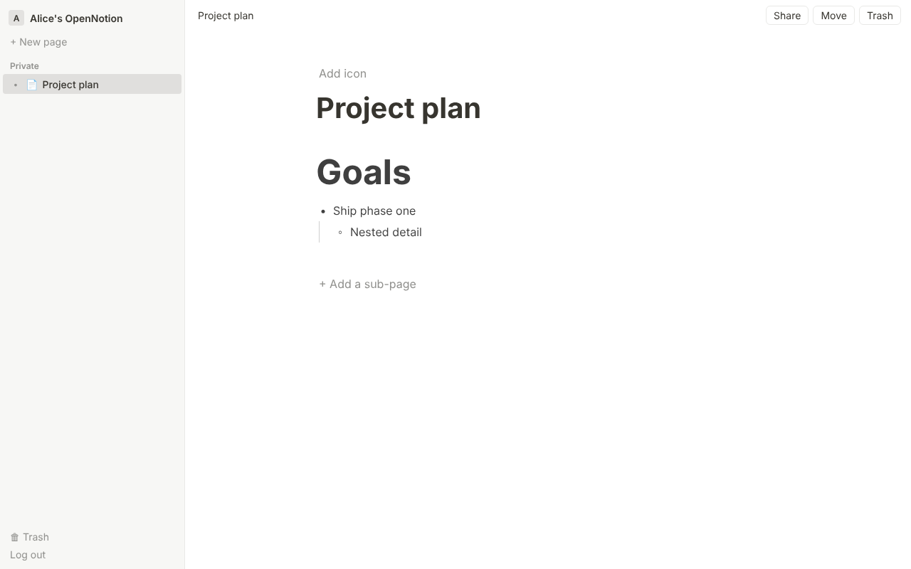

# OpenNotion

An open source, Notion-style workspace: nested pages, a block editor, and sharing.



## Status

This is phase 1 of the roadmap in the [design report](https://claude.ai/artifact/BQ26PkuqyemRuNoLzSPJBZ).

| Phase | Scope | State |
| --- | --- | --- |
| 1 | Accounts, page tree, block editor, sharing, trash | Done |
| 2 | Live co-editing (Yjs + Hocuspocus), presence, comments | Next |
| 3 | Databases (tables, boards, properties, views) | Planned |
| 4 | Search, version history, import/export, offline | Planned |

What works today:

- Sign up and log in (email and password, server-side sessions).
- A page tree of any depth in the sidebar. Create sub-pages, rename, pick an icon, move a page under another, send it to the trash, restore it, delete it forever.
- A block editor ([BlockNote](https://www.blocknotejs.org/)) with headings, lists, to-dos, quotes, code, tables, slash menu and drag handles. Blocks nest with Tab and save automatically.
- Sharing: invite people who have an account as viewers or editors, or turn on a public read-only link. Access granted on a page applies to every page under it, as in Notion.

## Stack

- [Next.js](https://nextjs.org/) 15 (App Router) with TypeScript
- [BlockNote](https://www.blocknotejs.org/) editor
- PostgreSQL through [Drizzle ORM](https://orm.drizzle.team/)

## Running it

You need Node.js 22 and PostgreSQL 16.

```bash
docker compose up -d          # or point DATABASE_URL at your own Postgres
cp .env.example .env.local
npm install
npm run db:migrate
npm run dev
```

Open http://localhost:3000 and sign up.

Other scripts: `npm test` (unit tests), `npm run lint`, `npm run build`, and `npm run db:generate` after changing `src/db/schema.ts`.

## How it is built

```
src/
  app/            routes: /login, /p/[id], and the JSON API under /api
  components/     sidebar, page view, editor, share and move dialogs
  db/schema.ts    tables: users, sessions, pages, blocks, page_shares
  lib/
    blocks.ts       editor document <-> block rows
    permissions.ts  role resolution with inheritance
    pages.ts        page tree, block saving, sharing queries
    auth.ts         password hashing and sessions
drizzle/          SQL migrations
```

**Data model.** Pages form a tree through `pages.parent_id`. Each block in a page is its own row in `blocks`, with a `parent_id` for nesting and a `position` among its siblings. This mirrors Notion's own record model (see [docs/reverse-engineering.md](docs/reverse-engineering.md)) and keeps the door open for linking and reusing blocks later. When the editor changes, the client sends the whole document after a short pause, and the server upserts the rows and removes the ones that are gone. Phase 2 replaces this with a Yjs document per page for live co-editing, and the block rows become a projection of it.

**Permissions.** A person's role on a page is the strongest of: owner, a share on the page or any ancestor, or a public link on the page or any ancestor (view only). Pages under a trashed page are hidden from everyone except the owner. Sub-pages always belong to the owner of the tree they live in, so the tree's sharing settings keep applying to them. The rules live in `src/lib/permissions.ts` and are covered by `tests/permissions.test.ts`.

## Notes on Notion

How Notion works was studied from public material only. See [docs/reverse-engineering.md](docs/reverse-engineering.md) for what was looked at, what was learned, and how to go further with REA on your own machine. No Notion code or assets are used.

## License

See [LICENSE](LICENSE).
